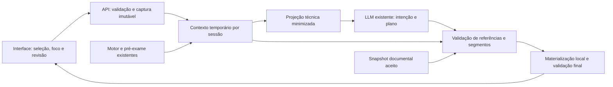
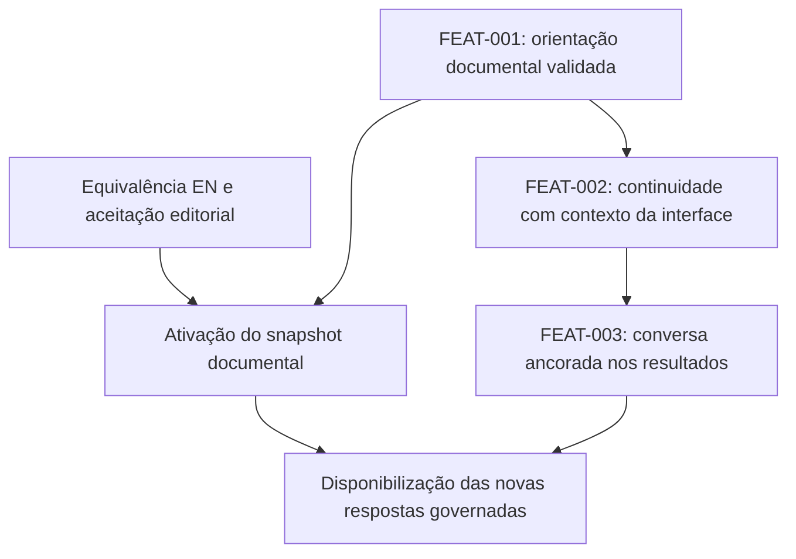

# Reavaliação do incremento conversacional — 16/10/2026

**Conclusão:** a localização e a correspondência estrutural do catálogo foram resolvidas. Sua aceitação como registro vigente **continua bloqueada** pela equivalência semântica PT/EN pendente, expressamente registrada na própria SPEC. A integração técnica é viável de modo incremental, mas ainda faltam materialização/validação documental, estado de sessão confiável e ancoragem da conversa nos resultados do servidor.

Este relatório é investigação e proposta de execução; não modifica nem substitui contratos normativos. Nenhuma capacidade aqui proposta foi implementada nesta etapa. Não houve alteração de código, testes, SPEC, catálogo, configuração ou dados; nem commit, push, merge, reset, instalação de dependência ou chamada ao LLM real.

## 1. Escopo, revisão e evidências

- Branch: `feat/novos-blocos-incrementais`.
- HEAD: `f0c152d7222f6d8d53a5b1b7b2a2758ac0382dfe`.
- `git ls-remote --heads origin feat/novos-blocos-incrementais` confirmou esse mesmo HEAD no remoto. A consulta inicial falhou por credenciais Schannel no ambiente restrito; a repetição com acesso ampliado, exclusivamente para leitura, funcionou.
- Incorporação do catálogo: `3ee8bdce2e3086f676b3dae1e23cc59353b93be1`.
- Desde o diagnóstico em `1f416825a57bead166e1a207f975dc359c02eed7`, o diff versionado contém somente a adição do catálogo e do diagnóstico anterior. O produto permaneceu igual. A árvore estava limpa no início desta reavaliação.

Fontes: [SPEC](../IMPLEMENTATION_SPEC.md), [catálogo integral](CFG_DOC_CATALOG.yaml), [diagnóstico anterior](DIAGNOSTICO_INCREMENTO_CONVERSACIONAL_20261016.md), [README](../README.md), [conversação incremental](CONVERSACAO_INCREMENTO_FN.md), [adaptações da ponte](SEMANTIC_BRIDGE_ADAPTACOES.md), documentos dos blocos analíticos e implementação atual de backend/frontend.

O planejamento usa requisitos efetivamente existentes na SPEC. Não foram encontrados documentos separados de SRS, casos de uso, arquitetura e UX com uma cadeia adicional de FR/UC/SCR; esses identificadores não são inventados aqui. `FEAT-001` a `FEAT-003` são apenas identificadores locais deste plano. Os componentes conceituais C-02/C-04/C-08/C-09/C-11/C-12 não exigem novos serviços físicos.

Nas seções seguintes, **norma** designa uma obrigação da SPEC/política vigente; **implementação** descreve código observado; **proposta** é uma escolha técnica ainda sujeita à autorização de execução.

## 2. Verificação integral do catálogo

### 2.1. Procedimento e resultado mecânico

O arquivo completo foi decodificado e percorrido, incluindo as 703 entradas e as 1.620 formas PT/EN. A auditoria em memória utilizou o PyYAML já instalado, detectando chaves duplicadas e tokens YAML especiais, e reconstruiu o texto PT pelo Anexo A: localizadores de linha e intervalos de caracteres, concatenados com LF. Foram verificadas também as condições localizadas, identidade fonte/caminho, pareamento de formas, variáveis e referências documentais explícitas. Não foi executado código contido no catálogo.

| Verificação executada | Resultado |
|---|---|
| Identificação e compatibilidade declaradas | `CFG-DOC-CATALOG`, versão `1.2.4`, SPEC compatível `1.2.4`, fonte `SPEC-1.2.4` |
| Inventário contra Anexo A | 703 entradas de 576 fontes; nenhuma ausente ou órfã; mesma ordem |
| IDs/chaves YAML duplicados; aliases, âncoras ou tags especiais | Nenhum encontrado |
| Localizadores de texto e condições do Anexo A | Nenhum localizador inválido encontrado |
| Identidade literal da forma PT `base` com o texto canônico extraído | **703 de 703** correspondentes |
| Inventário de formas | 810 PT e 810 EN: 703 `base` e 107 variantes em cada idioma |
| Pareamento PT/EN e estrutura das variantes | Formas pareadas; nomes/tipos das variáveis, condições e referências correspondentes; placeholders conferidos |
| Referências `DOC:` explícitas das formas | Resolvidas no inventário |
| Formas EN com versão inferior ao par PT | **74**, todas `base`; não habilitadas para uso conforme §4.4.23.6 |
| Revisão semântica integral EN registrada e concluída | **Não demonstrada; o próprio catálogo e §25.9 declaram pendência** |

As verificações mecânicas não certificam equivalência semântica, correção de todas as traduções, implementação dos predicados de aplicabilidade, nem execução de V-01 a V-16. Resolver um `DOC:` prova existência, não pertinência ao caso concreto. A equivalência semântica de todas as formas EN não foi aprovada por esta auditoria.

O conteúdo Git é UTF-8 sem BOM/LF. Os arquivos de trabalho têm CRLF; comparados normalizando **somente CRLF→LF em memória**, correspondem aos blobs Git. Não foram regravados para acomodar a verificação. SHA-256 da representação Git UTF-8/LF:

- Catálogo: `65766f37c27d1f2bc0a32cfeef928cdc59cb1bd968ddcaeedb607139c8827d89`.
- SPEC: `5769399e20b2f3492970951aea4d8b499e9b16e7c09a26e01a83522f2e20a11b`.

### 2.2. Impedimento documental que permanece

**Norma:** §4.4.23.4, passo 10, exige revisão de equivalência registrada para cada par EN/PT e impede aceitar materialização defeituosa como registro vigente. §4.4.23.5 exige aprovação editorial antes de publicar/usar o snapshot. §25.9, parágrafo D31, afirma expressamente que a equivalência integral pendente impede aceitar o catálogo como registro vigente. A SPEC se identifica como **CANDIDATA v1.2.4**, não como documentalmente fechada.

**Evidências:** `IMPLEMENTATION_SPEC.md:1247`, `:1259`, `:3199` e `:3209`; `CFG_DOC_CATALOG.yaml:10`. Não se trata de uma hipótese produzida pela auditoria nem de uma exigência adicional deste plano.

| Exemplo conferido | Evidência no catálogo | Consequência |
|---|---|---|
| `DOC:RQ-DOC-03` | PT em `:51`, EN em `:55` | EN conserva referência ao fechamento anterior; versões PT 1.2.4/EN 1.2.3 |
| `DOC:V-09` | PT em `:5124`, EN em `:5128` | PT explicita distinções de `INTERROMPIDO` e `CANCELADO` ausentes na forma EN anterior |
| `DOC:CAP-CMP-01.metodo` | PT em `:9042`, EN em `:9086` | PT usa o contexto de medida atualizado; EN conserva formulação anterior sobre escala ativa |
| `DOC:CFG-OPR` | PT em `:11085`, EN em `:11089` | EN anterior não representa integralmente o catálogo vigente de interações efetivas da sessão |

O Anexo deste relatório lista os 74 pares mecanicamente identificados. §25.9 também relata divergências em pares cujo PT não mudou; o registro externo dessa revisão não foi localizado neste repositório. Portanto, **corrigir somente os 74 pares ou comparar versões não comprovaria equivalência integral**.

Uma forma com versão 1.2.3 não é automaticamente inválida: a versão da forma identifica quando seu literal foi estabelecido. O impedimento específico dos 74 pares é a defasagem EN em relação ao PT correspondente; o impedimento de aceitação do conjunto é a revisão integral pendente.

**Não são soluções conformes:** retirar silenciosamente as entradas problemáticas, declarar o arquivo vigente apenas por seu cabeçalho, ativar uma cópia PT como se eliminasse o fechamento obrigatório, traduzir com o LLM ou usar o fallback de insuficiência como aprovação editorial. O fallback resolve ausência/incompatibilidade em execução; não autoriza fechamento documental incompleto.

### 2.3. Formas existentes e adequação ao incremento

O catálogo contém descrições de capacidades, métodos, pré-condições, limitações, governança e representação; TPL-01 a TPL-13; perguntas tipadas de TPL-04; perguntas de estrutura/substituição/mudança ou tendência; perguntas de natureza nominal; motivos de pendência; controle de encerramento; retirada/cancelamento; insuficiência documental; mínimo/bloqueio de observações de tendência; transições; e rótulos governados.

As 107 variantes por idioma são principalmente operacionais, perguntas e rótulos. Não constituem um repertório geral de paráfrases didáticas. Por exemplo, os aspectos de densidade possuem formas-base, sem versões livres “coloquial”, “simplificada” ou “para iniciantes”. A existência de `DOC:CAP-SIN-01.*` documenta a síntese; não implementa um sintetizador.

**Condições de uso que precisam ser implementadas:**

1. A chave é composta por `id_doc`, idioma e `id_forma_local`, com versões da fonte e da forma. IDs locais não são globais.
2. A forma `base` herda os metadados comuns: sem variáveis, descrição geral, preservação de condições/dependências e nenhuma alegação de aplicação concreta. Chaves em exemplos são literais metalinguísticos, não placeholders autorizados.
3. Variantes interpolam somente variáveis declaradas, com tipo, origem e âncora verificáveis. Texto do modelo não pode ocupar campos de método, fórmula, condição, justificativa ou rótulo.
4. Referências adicionais da variante somam-se às dependências da proposição. Condições precisam de predicados determinísticos ligados a controles existentes; não são instruções para o LLM decidir se estão satisfeitas.
5. Mensagem de bloqueio/aplicação exige evento, estado ou resultado concreto. Descrição de capacidade não prova disponibilidade para a seleção atual.
6. Omissões entre colchetes obedecem exclusivamente ao contrato de perguntas; não há permissão para editar cláusulas ou resumir o template livremente.
7. As formas permanecem congeladas no snapshot da sessão; uma nova versão não altera retroativamente sessões em andamento.

**Possibilidade de reutilização:** o catálogo pode ser carregado e auditado pela arquitetura atual, sem novo método ou alteração normativa. `uvicorn[standard]`, já declarado em `backend/requirements.txt`, inclui PyYAML; não é necessário acrescentar uma biblioteca externa para a leitura. Falta implementar o registro derivado do Anexo A e os controles de materialização. Um dicionário em memória derivado da fonte única não é um catálogo normativo concorrente. Não há necessidade de RAG, embeddings ou banco vetorial.

## 3. Cobertura de V-01 a V-16 e RQ-SIN

Todas as dez entradas RQ-SIN-01 a RQ-SIN-10 e as dezesseis entradas V-01 a V-16 estão no catálogo. A cobertura é **documental**; não significa que o backend execute esses validadores.

| Regra | Obrigação que a nova saída deverá cumprir |
|---|---|
| V-01 | Verificar todos os números, inclusive por extenso quando quantitativos, com origem, escala e arredondamento da apresentação; não recalcular no LLM |
| V-02 | Resolver entidades factuais para fontes autorizadas; distinguir conceito documentado de fato sobre dados |
| V-03 | Qualificação normativa somente com critério autorizado; critério do usuário identificado como tal |
| V-04 | Não afirmar causalidade sobre o fenômeno |
| V-05 | Classificação de tendência exige resultado correspondente de CAP-TEN-01; mudança entre períodos não se torna tendência por redação |
| V-06 | Distância conserva a indicação de TPL-11; não equivale a distância viária, deslocamento ou acessibilidade |
| V-07 | Comparações, percentuais, contagens e ordenações exigem relações estruturadas já produzidas |
| V-08 | Preservar todas as limitações analíticas e interpretações adotadas que precisem ser explicitadas |
| V-09 | Preservar situação dos entregáveis não atendidos junto dos resultados parciais; não converter bloqueio/falha em zero |
| V-10 | Sugestão identificada, capacidade ativa e aplicabilidade comprovadas; nenhuma execução automática |
| V-11 | Distinguir substituição de estado, mudança de foco e invalidação; não reclassificar tudo como “histórico” |
| V-12 | Destaques analíticos somente quando sustentados por pedido, seleção/ordenação ou regra autorizada |
| V-13 | Não qualificar heterogeneidade sem critério formal autorizado |
| V-14 | Distinguir soma dos componentes de pessoas/unidades distintas, preservando risco de dupla contagem e origem da premissa |
| V-15 | Conservar qualificadores de alcance, cobertura, coorte e situação do resultado |
| V-16 | Conferir forma literal materializada, versões, idioma, tipos, origens, condições, dependências e âncoras; rejeitar conteúdo adicional |

RQ-SIN-01 exige entradas completas e pertinentes; 02, segmentos tipados e função de conteúdo; 03 permite verbalizar o que já está estruturado; 04 exige validar **todo** texto do LLM exibido; 05 prevê até duas regenerações e fallback; 06 impede confundir busca lexical com validação; 07 limita variação semântica e paráfrase metodológica; 08 permite adaptar detalhe/condução; 09 conserva idioma e significado; 10 verifica função e suporte da afirmação. Referências: `IMPLEMENTATION_SPEC.md:2024–2056`.

`backend/llm_bridge.py:_validate` valida o contrato da interpretação. Não é o validador completo de síntese C-04/V-01–V-16. Um JSON bem formado e uma lista de palavras proibidas não preenchem essa lacuna.

## 4. Liberdade linguística possível

| Categoria | Autorização e limite normativo | Validação necessária | Evolução conforme possível |
|---|---|---|---|
| **A. Conversação sem conteúdo substantivo** | RQ-FLX-21 admite resposta conversacional breve a saudações/agradecimentos. RQ-SIN-02/04/10 e INV-13 continuam aplicáveis; não há dispensa geral para texto livre. Uma pergunta operacional substantiva pertence a B, mesmo sendo coloquial. | Verificar que os segmentos de ligação/cortesia não introduzem números, entidades, relações, norma, causalidade ou alegação de ação realizada. Classificação proposta pelo modelo não basta. | Interpretar cumprimentos e mudanças de intenção com mais flexibilidade; variar ligações não substantivas por composição verificável, ajustar concisão e evitar repetir a apresentação inicial. Usar gramática limitada para esses segmentos e fallback quando a ausência de conteúdo substantivo não puder ser demonstrada. |
| **B. Orientação e funcionalidades** | RQ-FLX-07/08, FN-META-01, §4.4.23.5, V-16 e RQ-SIN-10 exigem forma documental autorizada. Não permitem reescrever livremente métodos, procedimentos, alternativas ou justificativas. | V-16; estado de disponibilidade do pré-exame; âncora da pendência para perguntas; evento para bloqueios; tipos/origens de variáveis; demais V conforme incidência. | O LLM pode compreender a pergunta e selecionar aspectos/formas pertinentes, organizar a ordem, modular o detalhe e usar conectores. Perguntar somente o que falta. Mostrar possibilidades reais e admitir ausência de forma pertinente. |
| **C. Explicações e sínteses analíticas** | RQ-SIN-03/07 permite verbalizar valores, classes e relações já estruturados e organizá-los segundo o pedido. Trechos metodológicos continuam sujeitos à literalidade de B. Não autoriza cálculo, descoberta de relação, causalidade ou conclusão nova. | Segmentos tipados; sujeito, predicado e valor/relação ancorados; V-01–V-16 conforme incidência, com limitações e qualificadores obrigatórios. | O LLM propõe foco, referências e organização; uma realização linguística local verificável verbaliza fatos autorizados. Pode alternar panorama/detalhe e acompanhar perguntas sucessivas, sem enviar os valores protegidos ao provedor. |

**Limite central:** ampliar compreensão e continuidade é compatível com a SPEC; prometer vocabulário metodológico ilimitado ou simplificação por paráfrase livre não é. “Explique de maneira mais simples” pode levar a menor quantidade de aspectos, apresentação progressiva e formas mais curtas **quando existentes e suficientes**, nunca à supressão de ressalvas obrigatórias ou reescrita de uma forma-base.

A proposta de gramática limitada para conectores e realização factual é escolha de implementação, não criação de novas formas metodológicas autorizadas. Sua cobertura deve ser demonstrável por testes; frases fora da linguagem verificável são rejeitadas. Não usar outro LLM como juiz de equivalência ou validador da própria resposta.

## 5. O que mudou no diagnóstico e o que falta

| Item | Situação atual |
|---|---|
| Arquivo não localizado | **Resolvido:** arquivo incorporado no commit informado e auditado integralmente |
| Correspondência PT/Anexo A e inventário | **Verificada mecanicamente** nesta etapa |
| Registro documental vigente | **Bloqueado:** D31/equivalência integral EN e aprovação editorial não concluídas |
| Materializador, seleção de formas e V-16 | **Ausentes** no fluxo atual de respostas; arquivo não é carregado por esse fluxo |
| Síntese segmentada e V-01–V-16 | **Ausentes na extensão requerida**; schema atual controla interpretação, não prosa explicativa |
| Consciência de tela | **Parcial:** pré-exame fornece papéis e disponibilidade; faltam seleção capturada, resultado apresentado e vínculo confiável com a sessão |
| Continuidade | **Parcial:** quatro mensagens anteriores do usuário, regras locais de anáfora e revisão de contexto; faltam memória tipada de intenções, correções e referências |
| Registro confiável de resultados para a conversa | **Ausente:** API devolve ID/hash/metadados, sem resolução posterior por sessão no servidor |
| Ciclo de sessão/expiração/descarte | **Ausente na extensão normativa:** aceite no `sessionStorage` não é sessão de backend |
| Minimização de dados para o provedor | **Parcial:** projeção técnica do pré-exame e filtros conservadores existem; não constituem triagem integral de conteúdo nominal/protegido |

Evidências principais: `backend/llm_bridge.py:129,266,329,398,484`; `backend/llm_context.py:24`; `backend/main.py:590,800`; `frontend/src/AnalysisAssistant.tsx:106,151`; `frontend/src/App.tsx:197,282,307`; `frontend/src/SessionPrivacy.tsx:4`.

### 5.1. Funcionalidades reais e divergências preexistentes

O pré-exame e o motor implementam doze operações: quantitativos, densidade, distribuição/quantis, comparações, evolução temporal, agregação, distância espacial, rankings, rotatividade, relatórios, referência mais próxima e critérios combinados. O contrato principal do LLM contempla dez; `nearest` e `criteria` seguem preparação determinística (`backend/analysis_catalog.py`). O catálogo normativo possuir 26 capacidades não demonstra que todas estejam implementadas.

Uma descrição confiável deverá combinar: capacidade normativa, operação realmente implementada, suporte do caminho conversacional e situação atual do pré-exame. Separar **operacional**, **condicionada a dados/parâmetros**, **implementada apenas em outro caminho da aplicação** e **não implementada**. Não anunciar uma operação como executável apenas porque seu `DOC:` existe.

Duas divergências precisam permanecer explícitas:

- **Canal de análise:** RQ-FLX-14 restringe novas solicitações à conversação; o protótipo conserva acionamento por controles diretos. A divergência já está documentada no README e em `SEMANTIC_BRIDGE_ADAPTACOES.md:30`. Este incremento deve preservar a interface por determinação do pedido; não pode declarar que isso satisfaz integralmente RQ-FLX-14. A importação do catálogo não resolve o conflito. A eventual conformidade integral desse fluxo exige decisão de escopo separada, antes de alterar o produto.
- **Tendência:** `backend/main.py:380–388` apresenta `Estável`, `Mudança de direção`, `Crescimento` ou `Declínio` a partir das velocidades. CAP-TEN-01 e `CategoriaTendencia` exigem também aceleração/desaceleração e `SEM_CLASSIFICACAO` com motivo para estabilidade/mudança de direção (`IMPLEMENTATION_SPEC.md:390,415,1767`). Não se deve anunciar implementação integral de CAP-TEN-01 nem fabricar as classes ausentes na síntese. O incremento não corrigirá o método: referências que não satisfizerem V-05 ficarão fora da síntese analítica, preservando a apresentação existente e registrando a lacuna. A solução de conformidade desse cálculo pertence a trabalho separado autorizado.

> Atualização de 19/10/2026: CAP-TEN-01 implementada no motor da evolução temporal (as sete classes da DA-15, o motivo de Sem classificação e a aritmética exata); ver [EVOLUCAO_TEMPORAL_E_TENDENCIA.md](EVOLUCAO_TEMPORAL_E_TENDENCIA.md). O texto acima registra o estado de 16/10/2026 e não foi reescrito.

Essas constatações delimitam a promessa do plano. Não são autorização para reconstruir o motor, alterar a SPEC ou remover funcionalidades atuais.

## 6. Arquitetura mínima de consciência de tela

### 6.1. Reutilização e fronteiras

**Proposta:** estender `llm_context.py`, a ponte existente, os endpoints atuais e o estado já mantido por `App.tsx`. Acrescentar somente auxiliares locais de materialização/validação e um pequeno repositório de contexto em memória, porque hoje não existe dono confiável desse estado entre requisições. Não criar agente paralelo, banco, serviço externo, captura visual ou nova engine.

O diagrama é uma separação de responsabilidades dentro da aplicação atual; não propõe oito serviços. O snapshot documental aceito ainda depende da resolução de D31.

### 6.2. Estado local confiável e projeção externa

| Informação | Autoridade e representação local | Projeção permitida ao provedor |
|---|---|---|
| Base | Identidade/versão verificada pelo backend; origem e autorização de uso; hash já disponível | Presença, situação técnica e referência opaca; sem arquivo, nome, hash de dado ou registros |
| Seleção territorial | Captura da interface no envio; resolver IDs/nomes localmente e verificar pertencimento à base | Referência opaca à seleção e papel técnico; sem nomes/códigos municipais ou valores da base |
| Indicadores/dimensões | Enumerações autorizadas e vínculo local com os campos já reconhecidos | Papéis/enumerações técnicas; nunca nomes dos campos importados |
| Parâmetros | Valores/origens locais, confirmação e revisão; distinguir proposto/confirmado/executado | Situação técnica, tipo e referência; somente informação que a política permita expressamente |
| Operações | Pré-exame atual e capacidades implementadas | Identificadores técnicos, disponibilidade e motivo técnico minimizado |
| Resultados | Registro gerado pelo motor, com ID, parâmetros, método, base, escala, cobertura e limitações | Existência, referências opacas e tipos de blocos acessíveis; sem valores ou relações concretas protegidas |
| Conversa | Intenções aceitas, correções, pendências e referências das respostas validadas | Resumo tipado mínimo; não reenviar a transcrição inteira nem respostas locais preenchidas com dados |
| Alterações da tela | Eventos estruturados de seleção/parâmetro/foco, com revisão | Categoria da alteração e referências; não conteúdo arbitrário do navegador |

O backend mantém o contexto necessário à ancoragem; o LLM externo recebe somente a projeção permitida. Não se promete que o provedor “veja” nomes e valores que a política proíbe enviar. A conversa usa esses dados por resolução e materialização **locais**.

As referências externas devem ser aleatórias, limitadas à sessão e sem dados embutidos; um hash de município ou valor não constitui autorização para transmiti-lo. Mensagens atuais também precisam de proteção: resolver menções locais, substituir referências protegidas e aplicar a triagem vigente antes do envio. Filtros por maiúsculas/regex, sozinhos, não provam ausência de dados sensíveis. Quando a elegibilidade de um trecho não for demonstrada, não o transmitir. Preservar o caminho local e pedir apenas o esclarecimento pertinente.

### 6.3. Resultados, origem e validade

1. Ao concluir `/api/analyze`, registrar no servidor o resultado efetivamente calculado e seus metadados, associado à sessão. Guardar apenas o necessário à conversa e às âncoras; não acrescentar armazenamento de arquivos brutos.
2. A interface envia `result_id`/referência de apresentação, nunca um resultado que se torne autoridade apenas por chegar em JSON. O backend resolve a referência em seu próprio registro e valida sessão, origem, método, parâmetros e situação.
3. `execution_key` é um hash sem segredo, útil para identidade/comparação; **não autentica** um resultado reenviado pelo cliente. Não usá-lo como assinatura.
4. Manter separados: seleção atual, preparação ainda não executada, resultado apresentado e contexto original desse resultado. Mudança de período não cria um resultado para o novo período.
5. Capturar seleção/revisão imutáveis no envio, conforme RQ-FLX-16. Mudança posterior não altera o significado do pedido em trânsito. Resultado tardio não pode atualizar silenciosamente o contexto novo.
6. Registrar a causa da mudança: foco, substituição de estado ou invalidação. Um resultado válido de outro recorte pode ser consultado com esse recorte explícito; não se torna inválido só porque o usuário navegou. Base recusada ou referência invalidada não é reutilizada.
7. A síntese somente referencia relações já estruturadas. Se houver dois valores sem relação comparativa autorizada, orientar a operação existente; não subtrair, classificar ou ordenar no LLM/materializador.
8. Reutilizar escalas/arredondamentos e eventos de representação. Não descrever densidade por habitante se a apresentação efetiva está por 1.000, nem inferir a escala por ausência de outro campo.

Se faltarem metadados necessários a uma regra V, a afirmação correspondente não entra na síntese. Acrescentar metadados de proveniência a saídas existentes é diferente de calcular novas relações. Saídas cujo significado dependa de corrigir o motor ficam explicitamente pendentes.

### 6.4. Sessão, isolamento, expiração e concorrência

**Norma:** RQ-FLX-17/19 e CFG-OPR fixam 1.800 segundos sem interação efetiva e encerramento explícito, com descarte integral. Fechar a interface não encerra imediatamente. Renderização, polling, retries e retorno de LLM não renovam a sessão. O catálogo fechado de `TipoInteracaoUsuario` governa o que renova o prazo.

**Proposta mínima:** identificador imprevisível de sessão, emitido pelo backend e mantido por aba, com associação explícita das requisições; repositório em memória do processo atual, sem login nem persistência em disco. Não confiar em um ID escolhido pelo navegador nem expor o token ao LLM, aos logs ou a URLs. Validar escopo e sessão em toda resolução de referência. Duas abas novas não compartilham resultados por coincidência de parâmetros.

Usar relógio do servidor e verificações antes e depois de cada chamada assíncrona. Encerramento/expiração impede qualquer retorno tardio de recriar estado. Eventos válidos de usuário anteriores ao vencimento renovam o prazo; atividade automática não o faz. Manter limpeza periódica e no acesso, com limites de memória, sem retenção silenciosa indefinida.

No encerramento, liberar resultados, aliases, contexto, eventos e referências a dados da sessão; limpar os estados correspondentes no navegador. Preservar somente arquivos públicos/versionados preexistentes cuja existência é independente da sessão. Logs operacionais não devem conservar cópias de mensagens, dados ou resultados descartados. Rastreabilidade da sessão segue RQ-RAS, com eventos mínimos e encadeamento verificável em memória, também descartados conforme a política.

Aviso e controle **Encerrar sessão** são requisitos existentes, não redesenho visual. Devem ser integrados aos componentes atuais. Reabrir a interface antes da expiração pode consultar a mesma sessão ativa se o vínculo ainda existir; após o encerramento não há retomada. Reiniciar o processo elimina esse estado. A solução proposta assume uma instância/processo; implantação com múltiplos workers exigiria análise própria antes da ativação, sem introduzir Redis/banco por antecipação.

## 7. Integração com catálogo e validação

O percurso proposto amplia os mecanismos atuais:

1. **Carga governada:** ler SPEC/Anexo A/catálogo como um único snapshot; verificar inventário, versões, literais, dependências e evidência de aprovação editorial. Recusar sua ativação se a aceitação falhar. No estado atual, o resultado esperado dessa checagem é bloqueio por D31.
2. **Descoberta dirigida:** mapear operação/função existente para as fontes do Anexo A e relações de §4.4.23.6. Buscar por `id_doc`/forma; não varrer todo o catálogo a cada conversa nem criar um segundo catálogo autoral.
3. **Intenção e plano de resposta:** ampliar o schema atual para intenção de esclarecimento, retomada, correção e pedido de detalhe, e para seleção de referências/formas/ordem. O modelo não devolve valores de dados nem texto metodológico livre. O orçamento de 600 tokens exige planos compactos e respostas progressivas.
4. **Validação preliminar:** resolver referências somente no snapshot e na sessão; verificar função do segmento, disponibilidade real, pendência e aplicabilidade. Descrição geral, aplicação concreta e afirmação analítica têm requisitos distintos.
5. **Materialização local:** interpolar variáveis autorizadas e resolver valores factuais apenas localmente. Conservar ordem/cardinalidade, rótulos, opções, limitações e qualificadores; impedir campos extras e conteúdo protegido.
6. **Validação final:** aplicar regras V pertinentes ao texto efetivamente exibido, inclusive conectores e perguntas. Rejeitar o segmento rotulado incorretamente; rótulo `CONECTIVO` ou `EXPLICACAO_METODOLOGICA` não dispensa evidência.
7. **Falhas:** registrar violações; até duas regenerações, sempre dentro da cota existente. Sem orçamento, não insistir. Rejeitados nunca aparecem. Usar TPL-08/TPL-12 quando aplicáveis; ausência documental usa `DOC:CFG-DOC.comportamento/insuficiencia` no idioma da sessão, **somente a partir de snapshot aceito**. Não improvisar fallback livre para contornar a falta de registro vigente.
8. **Continuidade:** guardar os segmentos validados e suas referências no contexto local. Próximo turno retoma o foco/pendência, sem assumir que a última mensagem do usuário contém toda a investigação.

Os predicados documentais de uso são implementados explicitamente por forma/família de situação, reutilizando o pré-exame e as validações existentes. Não é necessário construir um interpretador genérico de português normativo. Forma sem predicado suficiente permanece indisponível para aplicação concreta.

## 8. Iterações propostas

A aprovação editorial é uma dependência externa de **ativação**, não uma alteração normativa incluída neste plano. O desenvolvimento de mecanismos e testes de rejeição pode ocorrer antes dela, após autorização; a entrega não deve anunciar a ativação governada enquanto esse requisito faltar.

### FEAT-001 — Orientação documental validada

| Campo | Proposta |
|---|---|
| Objetivo | Entregar um primeiro percurso completo de pergunta sobre funcionalidade → escolha documental → materialização → validação → resposta/falha governada |
| Capacidades | Reconhecer formulações alternativas sobre densidade/distância/funcionalidades; selecionar aspectos pertinentes e nível de detalhe disponível; tratar saudações sem apresentação repetitiva; distinguir descrição geral de operação aplicada |
| Componentes | `llm_bridge.py`, `llm_context.py`, rotas conversacionais de `main.py`; auxiliar local de carga/materialização/validação; `AnalysisAssistant.tsx` para remover apenas atalhos conflitantes desse percurso; documentação e testes |
| Dependências | Catálogo real como entrada; SPEC/Anexo A; contrato atual de interpretação. Snapshot editorialmente aceito é condição para ativação, não para escrever testes que demonstrem o bloqueio atual. A proteção da mensagem antecede qualquer chamada externa, mesmo nesta primeira fatia; trechos cuja elegibilidade não seja comprovada permanecem locais |
| Riscos | Uso indevido de `base` como mensagem; interpolação livre; ignorar EN defasado; alterar perguntas locais existentes; confundir o carregador com certificação semântica |
| Testes | Inventário integral e identidade PT; metadados herdados; adulteração de versão/texto/variável; dependência ausente; origem/tipo inválidos; pergunta sem pendência; forma EN defasada; falta de aprovação editorial; conteúdo livre rejeitado; contrato da API e orientação local sem provedor |
| Aceite | O catálogo atual é corretamente identificado como não ativável; nenhuma resposta rejeitada é exibida; todo trecho metodológico do percurso habilitado é reproduzível por forma/variáveis/âncoras; ausência de forma não gera paráfrase; nenhuma análise é executada pela explicação; regressão pertinente passa |
| Relação com objetivo original | Cria a base verificável para riqueza por seleção/organização e compreensão de diferentes perguntas, sem aumentar autoridade ou trocar modelo |

Não substitui de uma vez todos os textos legados nem declara conformidade global do protótipo. Fora do percurso migrado, os comportamentos existentes permanecem identificados como implementação parcial. Não há ativação silenciosa em produção de um novo fluxo cujo registro esteja bloqueado.

### FEAT-002 — Continuidade com contexto da interface

| Campo | Proposta |
|---|---|
| Objetivo | Fazer a conversa acompanhar seleção, preparação, intenções e correções, com sessão temporária confiável |
| Capacidades | Resolver “esses municípios”, “e agora?”, “acrescente outra dimensão” e mudanças de período pela seleção/pendência atual; não repetir perguntas já resolvidas; preservar correções ao atravessar uma pergunta conceitual; separar proposta de execução |
| Componentes | `llm_context.py`, rotas existentes e pequeno armazenamento em memória de sessão; `App.tsx`, `AnalysisAssistant.tsx`, `SessionPrivacy.tsx` e cliente da API; ponte semântica apenas nos pontos de resolução/revalidação |
| Dependências | FEAT-001 para respostas documentais; RQ-FLX-16/17, CFG-OPR e RQ-RAS; resolução territorial local e pré-exame atuais; triagem/minimização antes de chamar o provedor |
| Riscos | Vazar nomes/campos por histórico; compartilhar estado entre sessões; sobrescrever correção com resposta atrasada; renovar prazo por polling; confundir seleção com autorização de análise |
| Testes | Captura em todo envio; texto/seleção equivalentes sem pergunta redundante; conflito material com pendência; revisão durante chamada; duas sessões/abas; expiração no limite de 1.800 segundos; encerramento e retorno tardio; reconexão antes/depois do vencimento; payload externo inspecionado com dados sentinela; indisponibilidade do provedor sem perda da manipulação direta |
| Aceite | Cada resposta é ligada à captura correta; nenhuma alteração posterior muda essa captura; nenhuma referência cruza sessão; encerramento e expiração eliminam estado; nenhuma chamada automática renova prazo; nenhuma seleção ou explicação executa análise; payload não contém dados protegidos |
| Relação com objetivo original | Entrega continuidade, reconhecimento de correções, consciência de tela e menor repetição operacional |

O detalhe do resultado ainda não integra este aceite: reconhecer que existe um resultado é diferente de poder explicá-lo. A vinculação factual completa entra em FEAT-003.

### FEAT-003 — Conversa ancorada nos resultados

| Campo | Proposta |
|---|---|
| Objetivo | Responder sobre resultados calculados e sugerir aprofundamentos compatíveis com o contexto, sem novo cálculo |
| Capacidades | Explicar valores/relações autorizados; recuperar foco anterior; conservar recorte, escala e limitações; distinguir exibido/atual/não executado; modular detalhe pelas formas existentes; explicar possibilidades de comparação, agregação, quintis, distância e demais operações realmente disponíveis |
| Componentes | Registro do resultado ao final de `main.py:/api/analyze`; contexto/validador/materializador introduzidos antes; schema da ponte; passagem de referência do resultado exibido por `App.tsx`; metadados de proveniência quando suficientes, sem mudar cálculo |
| Dependências | FEAT-001/002; snapshot aceito; disponibilidade real das operações; resultados com metadados/âncoras suficientes. RQ-SIN-01–10 e V-01–16 passam a ser verificados no percurso de síntese |
| Riscos | Aceitar resultado forjado; confundir hash com autenticação; criar relação por cálculo no texto; omitir limitações; apresentar resultado antigo como atual; descrever como completa uma capacidade parcial, especialmente tendência |
| Testes | ID desconhecido/de outra sessão; resultado modificado pelo navegador; mudança de base/parâmetros em trânsito; foco versus substituição versus invalidação; todas as regras V com casos positivos/negativos; qualificadores de distância/coorte/agregado; relações ausentes; operação disponível apenas localmente; falta de forma; limite de regenerações/cota; jornadas de manipulação direta |
| Aceite | Toda afirmação factual resolve para resultado autorizado da sessão; nenhuma relação/valor é calculada pelo sintetizador; ressalvas obrigatórias preservadas; saída forjada nunca vira evidência; sugestão não executa; limites de implementação aparecem sem promessa de capacidade inexistente; regressão completa pertinente passa |
| Relação com objetivo original | Completa o percurso de investigação dialogada sobre resultados, com consciência contextual e aprofundamentos sucessivos dentro da liberdade autorizada |

As três iterações são fatias de comportamento verificável, não uma reconstrução horizontal do sistema. Qualidade linguística, privacidade e testes são partes de cada fatia; não ficam adiados para uma fase final genérica. Antes de codificar cada uma, detalhar somente seus contratos internos, aceites e tarefas, reaproveitando o que as anteriores estabelecerem. Não é necessário projeto visual novo.

## 9. Exemplos de evolução esperada — não implementada

Os itens abaixo descrevem comportamento de aceite, **não novas formas documentais autorizadas nem resultados de testes reais**.

| Interação | Limitação atual observada | Comportamento pretendido e limite |
|---|---|---|
| Selecionar três municípios e dizer “Compare esses municípios” | O modelo não recebe uma referência estruturada à seleção da tela | Resolver a seleção local capturada e preparar a comparação permitida; explicitar o universo localmente; perguntar somente se houver conflito material ou parâmetro ausente |
| Após um resultado, “E agora?” | Atalho no frontend pode devolver orientação fixa de preparação | Usar resultado/foco/pendência da sessão para escolher sugestões disponíveis; não iniciar operação |
| “O que esse resultado significa?” | Resultado renderizado como React não é contexto factual do modelo | Resolver o ID no servidor, selecionar fatos autorizados e explicar com formas pertinentes, escala e limitações |
| “Explique de maneira mais simples” | Não há intenção própria de detalhe nem seleção documental | Reduzir aspectos não necessários e apresentar progressivamente; se não houver forma mais simples suficiente, não inventar uma paráfrase |
| “Não, quero quantidade”; pergunta sobre o método; “pode continuar” | Histórico curto e anáforas pontuais podem perder a correção | Preservar a intenção corrigida em estado tipado, mantendo parâmetros ainda pendentes; continuidade não significa autorização automática de cálculo |
| “Quero acrescentar outra dimensão” | Orientação tende ao roteiro da operação ativa | Identificar a intenção de alterar a preparação; aproveitar dimensões já disponíveis e perguntar apenas a escolha realmente ausente |
| “E se eu mudar o período?” | Preparação e resultado podem ser confundidos na conversa | Explicar as condições documentadas; indicar que o resultado mostrado pertence ao período original e que o novo ainda não foi calculado |
| “Por que esse município apresenta densidade maior?” | Não existe síntese com relação/denominador ancorados | Separar comparação descritiva e explicação do indicador de causalidade. Usar somente relações/componentes já disponíveis; não deduzir causa social nem produzir decomposição nova |

Naturalidade será avaliada pela pertinência, continuidade, concisão e ausência de repetição desnecessária. Não será medida pelo aumento do tamanho das respostas nem pela substituição aleatória de palavras dos templates.

## 10. Estratégia de testes e avaliação

### 10.1. Evidência executada e limites

**Nesta etapa:** consulta de branch/remoto; diff em relação ao diagnóstico; inspeção de implementação/documentos; auditoria mecânica integral do catálogo; comparações de representação e hashes; inspeção dos pares defasados. O resultado estrutural positivo e o bloqueio documental estão separados nas seções 2–3.

**Referência anterior, sem nova execução aqui:** 446 testes de backend aprovados, sem pulos, com `PYTHONUTF8=1` e `ADT_REAL_DATA_DIR` apontando à raiz; dez jornadas de interface aprovadas com o Chrome instalado; build aprovado; governança aprovada em UTF-8; integridade da base verificada antes/depois. A execução padrão anterior teve 416 aprovados, uma falha de codificação no verificador de governança e 29 testes reais pulados; a execução completa nas condições documentadas resolveu essa situação. O build anterior exigiu acesso ampliado por erro de acesso do esbuild a diretórios ancestrais.

Esses resultados continuam sendo uma **baseline histórica**, não uma aprovação do catálogo, das capacidades propostas ou do HEAD atual por nova suíte. O diff mostra que código/testes do produto não mudaram desde essa baseline; não se repetiram suítes nesta investigação documental. Detalhes e condições constam do diagnóstico anterior. Não houve chamada real ao Gemini nesta etapa.

### 10.2. Testes determinísticos e integração simulada

- Cobertura de cada regra V com suporte válido e ausência/adulteração de suporte; função declarada enganosa; literal numérico por extenso; escala/arredondamento; comparação não estruturada; causalidade; omissão de ressalva.
- Catálogo completo versus Anexo A; identidade de forma-base; variáveis e campos extras; tipos/origens; mensagens sem evento; descrição geral indevidamente apresentada como método aplicado; idioma/versão; snapshot congelado; aprovação editorial ausente.
- Fluxos de múltiplos turnos: equivalências coloquiais, correção, mudança de intenção, pergunta conceitual intermediária, retomada, explicação mais curta e referência ao resultado mostrado. Asserções sobre intenções, âncoras, pendências e efeitos; não sobre uma única frase de prosa livre.
- Ataques: instruções para ignorar a SPEC em mensagem, nome de campo, dado, histórico e texto do provedor; troca de sessão; ID fabricado; hash recomputado; conteúdo adicional em variável de template; referência antiga após recusa de base.
- Concorrência/vida útil: seleção/parâmetro alterado durante requisição; encerramento durante Gemini/cálculo; retorno depois da expiração; evento automático tentando renovar prazo; reuso antes e depois de mudança de foco/estado.
- Privacidade: inspecionar o corpo efetivamente enviado ao provedor, incluindo histórico e chamadas de regeneração, com nomes/campos/valores sentinela. Assegurar ausência dos sentinelas e dos tokens internos de sessão.
- Custos: uma chamada consome a guarda existente; regenerações também; até duas regenerações, nenhuma após cota; fallback sem nova chamada; nenhuma rotina de teste reinicia contador para contornar limite.
- Interface: preservar execução/manipulação direta já existente e funcionamento sem LLM; seletores estáveis; qualquer novo `ui_*.py` registrado em `run_ui_checks.py`.

### 10.3. Avaliação com o LLM real, quando autorizada

Usar o modelo/configuração atuais: `gemini-3.5-flash-lite`, temperatura 0, máximo de 600 tokens de saída, timeout de 22 segundos e guarda local de 20 chamadas por dia. A guarda é por processo e não um controle de faturamento do provedor; não se deve reiniciar o processo para aumentar o orçamento de avaliação.

Depois dos testes offline, executar corpus curto com dados sintéticos locais e projeção técnica inspecionada: inicialmente quatro diálogos de até três turnos, **somente se houver cota disponível**, reservando margem para regenerações. Contar toda chamada, interromper antes do limite e documentar casos não executados. Não alterar configuração/cotas, não usar dados reais protegidos e não embutir avaliações reais no CI.

Avaliar separadamente: compreensão da intenção; referência contextual correta; correção preservada; esclarecimento pertinente; repetição desnecessária; nível de detalhe; pertinência da sugestão; cumprimento das formas. Usar rubrica por caso e revisão humana das respostas, sem exigir frase exata. Temperatura zero não impede diversidade entre intenções/contextos; não é necessário aumentá-la para esse objetivo.

Aceite de segurança: nenhuma afirmação sem suporte, vazamento ou operação indevida nos casos executados. Aceite comportamental: cada jornada demonstra o comportamento-alvo sem perda de correções/âncoras nem pergunta redundante; falhas ficam registradas e impedem declarar aquela capacidade aprovada. Uma amostra pequena não prova qualidade irrestrita do modelo. Resultados simulados comprovam integração; somente chamadas reais avaliam o comportamento efetivo do provedor.

### 10.4. Regressão a executar na implementação

Em cada alteração relevante, rodar os testes do percurso e os contratos afetados. Para concluir as fatias que toquem API/integração, executar backend completo, backend com dados reais e hashes antes/depois, build e jornadas UI registradas, além do verificador de governança. Usar as condições Windows documentadas (`PYTHONUTF8=1`; diretório real explícito; navegador disponível), sem enfraquecer testes.

Atualizar documentação de comportamento e `REGISTRO_DE_COMPORTAMENTO.md` junto da futura implementação, conforme AGENTS.md. Este relatório não registra mudança de produto porque nenhuma foi realizada. Não há autorização de push implícita nesse plano.

## 11. Decisões humanas e recomendação

1. **Fechamento documental:** obter do responsável o catálogo com revisão integral EN e aprovação editorial registradas, ou autorizar uma atividade editorial específica no processo governado de origem. A segunda opção tem trabalho de revisão maior; a primeira depende de artefato já aprovado. Nenhuma permite simplesmente ignorar D31, alterar formas nesta etapa ou declarar a cópia atual vigente.
2. **Execução do incremento:** autorizar separadamente FEAT-001, com o bloqueio de ativação explícito. É possível implementar e testar carga, rejeição e materialização sem publicar o snapshot reprovado; isso não entrega ainda a nova experiência ao usuário final.
3. **Expectativa de linguagem:** aceitar o máximo permitido por seleção/organização, realização factual verificável e adaptação progressiva. Se forem exigidas paráfrases metodológicas irrestritas, o requisito é incompatível com a SPEC atual. Formas didáticas adicionais dependeriam de processo editorial próprio, fora deste plano; não são solução automática nem autorização recebida.
4. **Divergências preexistentes:** preservar a operação direta por escopo do pedido e não prometer conformidade integral de RQ-FLX-14; não ampliar a síntese para resultados que não satisfaçam V-05. Uma eventual correção desses pontos exige decisão separada, sem modificar métodos ou interface antecipadamente.
5. **Avaliação real:** autorizar as chamadas de avaliação quando o percurso estiver pronto e a disponibilidade de cota for conhecida. Não é necessário decidir novo modelo, dependência, banco ou prazo de sessão.

**Primeira iteração recomendada: FEAT-001.** É a menor entrega que resolve o mecanismo comum às explicações, perguntas e sínteses sem mexer no motor. Seu primeiro critério é justamente rejeitar a ativação indevida do catálogo atual. FEAT-002 acrescenta continuidade e consciência de seleção; FEAT-003 acrescenta fatos ancorados nos resultados. A ativação das novas respostas documentais permanece condicionada ao fechamento exigido pela SPEC.

A autorização para modificar o produto continua pendente. Este relatório encerra somente a reavaliação técnica solicitada.

## Anexo — Formas EN com versão anterior ao par PT

Lista derivada mecanicamente do catálogo incorporado; todas são formas locais `base`. Não substitui revisão semântica dos demais pares.

| id_doc | Versão PT | Versão EN | Linha PT | Linha EN |
|---|---|---|---|---|
| `DOC:RQ-DOC-03` | 1.2.4 | 1.2.3 | 51 | 55 |
| `DOC:RQ-CFG-14` | 1.2.4 | 1.2.3 | 630 | 634 |
| `DOC:RQ-DAD-20` | 1.2.4 | 1.2.3 | 931 | 935 |
| `DOC:RQ-DAD-23` | 1.2.4 | 1.2.3 | 1014 | 1018 |
| `DOC:RQ-DAD-37` | 1.2.4 | 1.2.3 | 1036 | 1040 |
| `DOC:RQ-DAD-38` | 1.2.4 | 1.2.3 | 1047 | 1059 |
| `DOC:RQ-DAD-39` | 1.2.4 | 1.2.3 | 1074 | 1078 |
| `DOC:RQ-DAD-31` | 1.2.4 | 1.2.3 | 1290 | 1294 |
| `DOC:RQ-DAD-33` | 1.2.4 | 1.2.3 | 1312 | 1316 |
| `DOC:RQ-DAD-41` | 1.2.4 | 1.2.3 | 1334 | 1338 |
| `DOC:RQ-DAD-34` | 1.2.4 | 1.2.3 | 1345 | 1349 |
| `DOC:RQ-DAD-42` | 1.2.4 | 1.2.3 | 1367 | 1371 |
| `DOC:RQ-FLX-01` | 1.2.4 | 1.2.3 | 1425 | 1563 |
| `DOC:RQ-FLX-21` | 1.2.4 | 1.2.3 | 1816 | 1820 |
| `DOC:RQ-FLX-22` | 1.2.4 | 1.2.3 | 1827 | 1831 |
| `DOC:RQ-GOV-08` | 1.2.4 | 1.2.3 | 1944 | 1948 |
| `DOC:RQ-GOV-09` | 1.2.4 | 1.2.3 | 1955 | 1959 |
| `DOC:RQ-GOV-17` | 1.2.4 | 1.2.3 | 2084 | 2112 |
| `DOC:RQ-GOV-18` | 1.2.4 | 1.2.3 | 2143 | 2255 |
| `DOC:RQ-GOV-19` | 1.2.4 | 1.2.3 | 2362 | 2366 |
| `DOC:RQ-CAP-08` | 1.2.4 | 1.2.3 | 2623 | 2627 |
| `DOC:RQ-ORQ-14` | 1.2.4 | 1.2.3 | 2896 | 2900 |
| `DOC:RQ-ORQ-16` | 1.2.4 | 1.2.3 | 2918 | 2922 |
| `DOC:RQ-RES-04` | 1.2.4 | 1.2.3 | 2962 | 2966 |
| `DOC:RQ-RES-06` | 1.2.4 | 1.2.3 | 2994 | 2998 |
| `DOC:RQ-DEG-02` | 1.2.4 | 1.2.3 | 3841 | 3845 |
| `DOC:RQ-DEG-05` | 1.2.4 | 1.2.3 | 3874 | 3878 |
| `DOC:RQ-RAS-02` | 1.2.4 | 1.2.3 | 3951 | 3968 |
| `DOC:RQ-QUA-05` | 1.2.4 | 1.2.3 | 4326 | 4330 |
| `DOC:RQ-QUA-06` | 1.2.4 | 1.2.3 | 4337 | 4341 |
| `DOC:RQ-QUA-07` | 1.2.4 | 1.2.3 | 4348 | 4352 |
| `DOC:INV-16` | 1.2.4 | 1.2.3 | 4524 | 4528 |
| `DOC:V-09` | 1.2.4 | 1.2.3 | 5124 | 5128 |
| `DOC:ENUM-StatusEntregavel` | 1.2.4 | 1.2.3 | 7111 | 7117 |
| `DOC:ENUM-TipoPendencia` | 1.2.4 | 1.2.3 | 7156 | 7162 |
| `DOC:GLOSSARIO-Entreg%C3%A1vel` | 1.2.4 | 1.2.3 | 7760 | 7764 |
| `DOC:GLOSSARIO-Sess%C3%A3o` | 1.2.4 | 1.2.3 | 7848 | 7852 |
| `DOC:GLOSSARIO-Pend%C3%AAncia` | 1.2.4 | 1.2.3 | 7881 | 7885 |
| `DOC:GLOSSARIO-Conjunto%20de%20op%C3%A7%C3%B5es%20autorizadas` | 1.2.4 | 1.2.3 | 7892 | 7896 |
| `DOC:GLOSSARIO-Triagem%20estrutural%20e%20de%20privacidade` | 1.2.4 | 1.2.3 | 8002 | 8006 |
| `DOC:GLOSSARIO-Escala%20de%20apresenta%C3%A7%C3%A3o` | 1.2.4 | 1.2.3 | 8189 | 8193 |
| `DOC:CAP-CMP-01.metodo` | 1.2.4 | 1.2.3 | 9042 | 9086 |
| `DOC:CAP-SUB-01.metodo` | 1.2.4 | 1.2.3 | 9766 | 9773 |
| `DOC:CFG-EXC` | 1.2.4 | 1.2.3 | 10307 | 10324 |
| `DOC:CFG-VOC` | 1.2.4 | 1.2.3 | 10492 | 10553 |
| `DOC:CFG-AMB` | 1.2.4 | 1.2.3 | 10602 | 10614 |
| `DOC:CFG-OPC` | 1.2.4 | 1.2.3 | 10629 | 10654 |
| `DOC:CFG-LEX` | 1.2.4 | 1.2.3 | 10694 | 10707 |
| `DOC:CFG-TPL` | 1.2.4 | 1.2.3 | 10723 | 10768 |
| `DOC:CFG-PRV.privacidade` | 1.2.4 | 1.2.3 | 10858 | 10888 |
| `DOC:CFG-DOC.definicao` | 1.2.4 | 1.2.3 | 10972 | 11018 |
| `DOC:CFG-DOC.metodo` | 1.2.4 | 1.2.3 | 11025 | 11046 |
| `DOC:CFG-DOC.comportamento` | 1.2.4 | 1.2.3 | 11053 | 11070 |
| `DOC:CFG-OPR` | 1.2.4 | 1.2.3 | 11085 | 11089 |
| `DOC:LIMITACAO-COBERTURA_PARCIAL` | 1.2.4 | 1.2.3 | 11306 | 11310 |
| `DOC:LIMITACAO-UNIDADES_NAO_AVALIAVEIS` | 1.2.4 | 1.2.3 | 11317 | 11321 |
| `DOC:LIMITACAO-UNIVERSO_OBSERVADO_NAO_EXAUSTIVO` | 1.2.4 | 1.2.3 | 11328 | 11332 |
| `DOC:LIMITACAO-AGREGADO_PARCIAL` | 1.2.4 | 1.2.3 | 11339 | 11343 |
| `DOC:LIMITACAO-SOMA_COM_POSSIVEL_DUPLA_CONTAGEM` | 1.2.4 | 1.2.3 | 11350 | 11354 |
| `DOC:LIMITACAO-ADITIVIDADE_POR_PREMISSA_DO_USUARIO` | 1.2.4 | 1.2.3 | 11361 | 11365 |
| `DOC:LIMITACAO-COMPARABILIDADE` | 1.2.4 | 1.2.3 | 11372 | 11376 |
| `DOC:LIMITACAO-NIVEIS_TERRITORIAIS_DIFERENTES` | 1.2.4 | 1.2.3 | 11383 | 11387 |
| `DOC:LIMITACAO-COBERTURA_DESIGUAL_ENTRE_PERIODOS` | 1.2.4 | 1.2.3 | 11394 | 11398 |
| `DOC:LIMITACAO-CATEGORIAS_NAO_COMPARAVEIS` | 1.2.4 | 1.2.3 | 11405 | 11409 |
| `DOC:LIMITACAO-DIFERENCA_DE_DEFINICAO` | 1.2.4 | 1.2.3 | 11416 | 11420 |
| `DOC:LIMITACAO-VALOR_FORNECIDO_PELO_USUARIO` | 1.2.4 | 1.2.3 | 11427 | 11431 |
| `DOC:LIMITACAO-VALOR_SUBSTITUIDO_PELO_USUARIO` | 1.2.4 | 1.2.3 | 11438 | 11442 |
| `DOC:LIMITACAO-DENOMINADOR_ALTERNATIVO` | 1.2.4 | 1.2.3 | 11449 | 11453 |
| `DOC:LIMITACAO-CRITERIO_NORMATIVO_DO_USUARIO` | 1.2.4 | 1.2.3 | 11460 | 11464 |
| `DOC:LIMITACAO-DISTANCIA_GEODESICA_DIRETA` | 1.2.4 | 1.2.3 | 11471 | 11475 |
| `DOC:LIMITACAO-EMPATE_NO_CORTE` | 1.2.4 | 1.2.3 | 11482 | 11486 |
| `DOC:LIMITACAO-CONJUNTO_VAZIO_ANTERIOR` | 1.2.4 | 1.2.3 | 11493 | 11497 |
| `DOC:LIMITACAO-ORIGEM_INDISPONIVEL` | 1.2.4 | 1.2.3 | 11504 | 11508 |
| `DOC:ENUM-MotivoBloqueioBase` | 1.2.4 | 1.2.3 | 11530 | 11536 |
